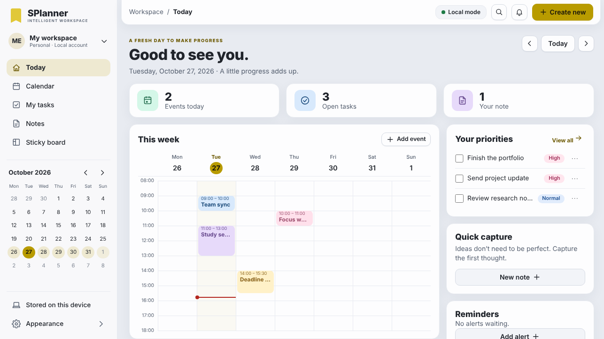

# SPlanner — SLAI v2.4

SPlanner is a local-first planning workspace: a calendar, tasks, notes and a sticky board that stay on your own computer.
It is the first SLAI application built on the shared kit in [`applications/tools`](../tools/README.md), so it looks and
behaves like Reader and SciCal: same server security, same dialogs and menus, same themes.



## Run

From the root of the SLAI checkout:

```bash
python -m pip install -r applications/splanner/requirements.txt
python -m applications.splanner            # or:  python applications/splanner/run_splanner.py
```

SPlanner prints a link such as `http://127.0.0.1:8769/?token=…` and opens it. The token is random for every start, is traded
once for a private cookie and is never stored. The server refuses any address that is not loopback.

| Option | Meaning |
| --- | --- |
| `--no-browser` | start the server only |
| `--port 8770` | choose the port (default 8769; Documaster 8766, Reader 8767, SciCal 8768, GangUP 8765) |
| `--data-dir PATH` | where SPlanner keeps its data |
| `--config PATH` | a YAML file instead of `configs/config.yaml` |
| `--slai-root PATH` | the SLAI checkout, if it cannot be found automatically |

Data lives in `%LOCALAPPDATA%\SLAI\SPlanner` on Windows and `$XDG_DATA_HOME/slai/splanner` (or `~/.local/share/slai/splanner`)
elsewhere. Click **Stored on this device** in the sidebar to see the folder, the size and the backups.

The built client is committed in `dist/`, so Node is only needed to change the TypeScript: `npm install && npm run build`.

## What it does

* **Today** — a greeting, the number of events today, open tasks and notes, this week at a glance (click an event to open it), your
  highest-priority tasks, a quick-capture button and the reminders that are waiting.
* **Calendar** — week, day and month views. Click an empty slot to start an event there; drag a block to move it, drag its bottom
  edge to resize it (15-minute steps); with the keyboard use `Alt+↑/↓/←/→` to move and `Alt+Shift+↑/↓` to resize. Overlapping
  events sit side by side, all-day events have their own strip, a red line marks now. Events have a place, a note, a colour and an
  optional reminder.
* **Repeating events** — choose *Repeats* in the event dialog: every day, every weekday, every week, every 2 weeks (bi-weekly),
  every month, every 2 months (bi-monthly), every 3 months (quarterly), every 4 months (a trimester), every 6 months, every year,
  or **Custom…**: every *N* days, weeks, months or years, on chosen weekdays, on a date or on the *n*-th weekday of the month.
  A repeat can run forever, until a date, or for a number of times. Repeating events show a repeat mark in the week, day and
  month views. **Dragging or `Alt`+arrow moves only that one occurrence** (*Undo move* in its dialog puts it back); **editing in the
  dialog changes the whole series**; deleting asks *Only this event* or *All events*. A repeating event's reminder is set for
  the next occurrence and moves on when dismissed.
* **My tasks** — add with Enter, tick, edit, priority (high, normal, low), due date with an optional time (a date alone means the end
  of that day), grouped as Overdue, Today, Upcoming, No due date and Done; filter by status, priority and text.
* **Notes** — each note is a real SLDC document, saved as you type (a moment after you pause), pinned to the top if you like,
  searchable, downloadable as `.sldc`. If a note changes somewhere else while you are editing it, SPlanner offers *Load the latest*
  or *Keep my text* and never overwrites silently.
* **Sticky board** — drag notes by the handle (or with the arrow keys), five colours, text saved as you type; each sticky is also
  an SLDC document. **Resize** a note by its bottom-right corner (or focus the corner and use the arrow keys, 16 px a step, `Shift` for
  64 px; `Esc` cancels a drag; double-click or *Reset size* goes back to the default). Size is kept between 150×110 and 1000×1000.
* **Reminders** — alerts at the right time while SPlanner is open, with a sound and, if you allow it, a browser notification.
  Dismiss, or **snooze** for +1, +5, +10, +15, +30 or +60 minutes, or *Snooze custom…* for any whole number of minutes, hours or
  days (up to 30 days). An event's reminder moves with the event.
* **Search** — `Ctrl+K` (or `/`) searches events, tasks, notes, stickies and reminders together.
* **Appearance and settings** — system, light, dark or high-contrast theme; text size; reduced motion; week starts on Monday or
  Sunday; 24- or 12-hour clock; working hours shown on Today; default length and reminder for new events; which view opens first;
  alert sound and volume; workspace name and initials.
* **Your data** — back up now; export the calendar as `.ics` (RFC 5545, opens in any calendar app) or everything as `.json`.
  A backup is also made about once a week and before any upgrade of the data format.

Works with the keyboard throughout, with screen readers (landmarks, labelled controls, live announcements), at 85–140 % text size,
down to a phone-width window (the sidebar becomes a drawer), and in forced-colours mode.

## How it is built

```
applications/splanner/
  __init__.py  __main__.py  run_splanner.py     entry points
  app.py        settings, preferences, start-up, automatic backups
  routes.py     the HTTP API
  store.py      SQLite (events, tasks, reminders, sticky positions and sizes) + SLDC notes
  configs/config.yaml
  recurrence.py the one engine that turns a repeat rule into dates (the browser only shows them)
  src/core/     pure TypeScript: dates and time zones, overlap layout, task grouping, reminder timing, repeat labels
  src/client/   the interface (views/, timegrid, editors, alerts, settings, search, shell)
  tests/  tests_ts/  tests_e2e/
  dist/         the built client
```

**Shared with the other SLAI applications (all from `applications/tools`, none copied):** the loopback server, token and cookie
handshake, Host/Origin/marker checks and CSP; error and validation vocabulary; atomic file writes; JSON preferences; SQLite with
migrations and backups; the `config.yaml` loader (over SLAI's `ConfigRepository`); the DOM builder, API client, dialogs, menus,
toasts, icons and appearance controls; and the stylesheet with its themes. **Used from SLAI itself:** `src.utils.sldc` for every
note, `ConfigRepository` for settings, and the shared `applications/assets` folder as the fallback behind SPlanner's own `assets/` (logo and alert sounds). See [`REUSE_AUDIT.md`](REUSE_AUDIT.md).

**Storage.** Files are written through the shared kit: a temporary file is renamed into place, and where Windows refuses the
rename (`WinError 17` in a redirected or virtualised AppData folder, as with some Microsoft Store Python installs) the data is
written straight into the file instead, so a note is saved either way. `planner.sqlite3` (WAL) holds events, tasks, reminders, sticky positions and a list of notes with their title,
pin and a short derived excerpt and search text that can always be rebuilt from the files. Each note and each sticky is
`notes/<opaque id>.sldc`. Timestamps are stored in UTC with an explicit offset; an event also keeps its IANA time zone, and
all-day events keep their calendar date. Every record has a `version`; a stale edit is refused with *409 Conflict* instead of
overwriting a newer one. Limits: 50,000 events, 50,000 tasks, 20,000 notes, 20,000 reminders, 500 stickies; a note is at most
50,000 characters, a sticky 2,000. A repeat is limited to every 999 units, 999 times and 2,000 changed or removed occurrences;
one request expands at most 30,000 occurrences over at most 900 days.

**Repeats.** The server stores one record per series (`recurrence`, and `exceptions` for moved or removed occurrences, keyed by the
occurrence's original start) and expands it for the window being shown, in the event's own time zone, so 10:00 stays 10:00
across a daylight-saving change. A monthly repeat on the 29th–31st uses the month's last day in shorter months. All-day events
repeat by date.

**Upgrading.** The database is now schema 3 (repeats, snooze of occurrences, sticky sizes). Older databases are upgraded in
place on first start after a copy is saved in `backups/`; existing events, notes and stickies are unchanged.

**Upgrading from 0.1.** The 0.1 database is upgraded in place on first start, after a copy is saved in `backups/`; notes, stickies
and their files are kept as they are.

**Settings** (`configs/config.yaml`, all optional): `port`, `reminder_poll_seconds`, `max_request_bytes`, `backup_every_days`,
`backup_keep`. Personal choices are saved in the app, not in the file.

### API

All paths are under `/api`, JSON in and out as `{"ok": true, "data": …}` or `{"ok": false, "error": {"code", "message", "hint"}}`.
Writes need the `X-SLAI-Splanner: 1` header. `GET bootstrap · snapshot · counts · status · search?q= · prefs · reminders/due ·
occurrences?from=&to= · export/json · export/ics`; `POST backup`; `PATCH prefs`; and `GET/POST /{events,tasks,notes,reminders,stickies}`,
`GET/PATCH/DELETE /{kind}/{id}`, `POST tasks/clear-completed`, `GET notes/{id}/file`. Updates take the record's `version`.
`snapshot` and `occurrences` accept `from` and `to` (dates or instants) and return each occurrence of a repeating event with
its `occurrence` key and `moved` flag. An event has `recurrence` (`{freq: daily|weekly|monthly|yearly, interval, weekdays,
month_mode: date|weekday, until, count}` or `null`) and `exceptions`; a sticky has `width` and `height` (`null` = default); a
reminder snooze is `PATCH reminders/{id}` with `{"action": "snooze", "minutes": 1–43200}`. `export/ics` writes `RRULE` and `EXDATE`.

## Tests

```bash
python -m unittest discover -s applications/splanner/tests -t .          # 94 Python tests (store, repeats, API, upgrades)
python -m unittest discover -s applications/tools/tests -t .             # 44 Python tests for the shared tools
npm test                                                                  # 27 TypeScript tests (tsx), in applications/splanner
npm run test:compiled                                                     # the same files, compiled with tsc and run by node --test
npm run test:e2e                                                          # 99 tests: real Chromium against the real server (needs Playwright)
```

The Python tests use the real SLDC module, SQLite and the loopback server. The TypeScript date tests are written to hold in any
time zone and were run in UTC, Europe/Amsterdam, America/Los_Angeles, Asia/Kolkata and Pacific/Auckland. The browser tests drive
the built client with a real mouse and keyboard: create, edit, repeat, drag, resize, snooze, autosave, conflicts, reminders, settings, backups,
exports, a stopped server, focus handling and a phone-sized window. `SPLANNER_SHOTS=1 npm run test:e2e` refreshes
`docs/screenshots/`.

## Not implemented yet

SPlanner does not claim any of these:

* **Recurring tasks**, and *"this and all following events"* when editing a repeat. Repeating events are supported; a change in the
  dialog applies to the whole series, a drag to one occurrence.
* **Alerts while SPlanner is closed.** Reminders are checked while a page is open; a browser notification needs your permission
  and also only works while the page is open.
* **Importing `.ics`**, or syncing with an outside calendar.
* **Reader and Writer hand-off**, or Reader's ink and annotation tools. There is no agreed hand-off contract yet.
* **Sharing, accounts and sync between computers.** SPlanner is single-user and loopback-only on purpose.
* **SLAI agents** (scheduling help, planning proposals). They need a consent and proposal contract first.
* **Rich text in notes.** The editor is plain text. A note that has formatting, images, signatures or comments (for example one
  edited in Reader or Writer) is opened read-only with a message, rather than flattened and damaged.
* **Recovering unsaved typing after a crash.** Notes save a moment after you pause typing, and the page asks before it is
  closed with unsaved changes, but a hard crash in that moment can lose it.
* **Installers** and release signing. Windows and macOS were not exercised for this change; the browser tests ran on Linux.

## Security notes

Loopback only; random per-start token traded for an `HttpOnly`, `SameSite=Strict` cookie; `Host` check; `Origin` and marker header
on every write; request-size cap; strict CSP with no inline script or style; note file names are opaque ids, never paths from the
browser. SQLite's WAL files are part of the database: copy the data folder while SPlanner is stopped, or use *Back up now*,
which uses SQLite's online backup and is coherent while it runs.
